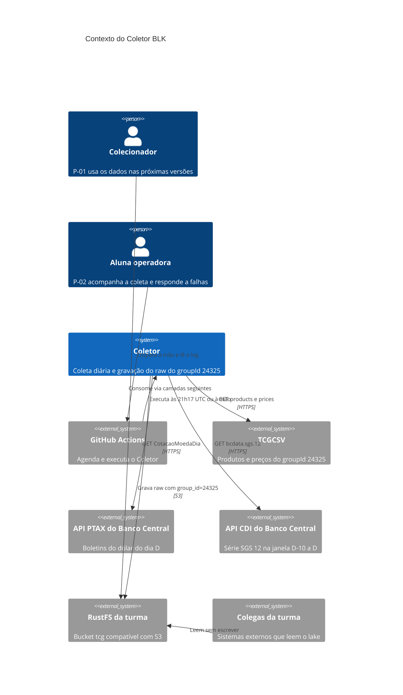
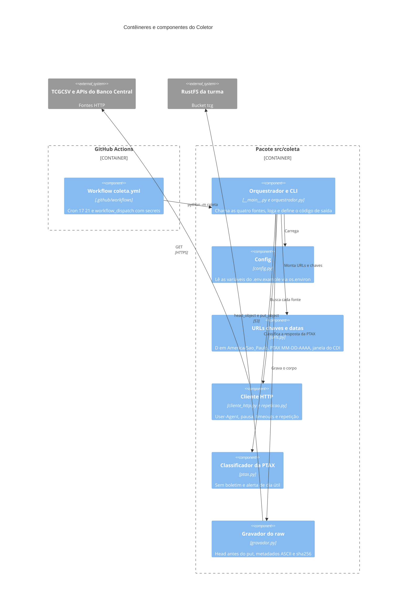

# Plano — Coleta diária e camada bruta (versão 1)

Cobre só `specs/spec.md` v1 (RF-01 a RF-12, RNF-01 a RNF-04). Tarefas em `specs/tasks.md`. Personas em `docs/00_persona.md`.

## Diagrama C4 de contexto

Nomes usados no texto: Colecionador, Aluna operadora, Coletor, TCGCSV, API PTAX do Banco Central, API CDI do Banco Central, RustFS da turma, GitHub Actions, Colegas da turma.

## Diagrama C4 de contêineres e componentes

Nomes usados no texto: Workflow coleta.yml, Orquestrador e CLI, Config, URLs chaves e datas, Cliente HTTP, Classificador da PTAX, Gravador do raw.

## Escolhas técnicas

| Escolha | Alternativa descartada | Requisito |
|---|---|---|
| Python 3.14 com `.venv` e `requirements.txt` com versões fixadas, igual no local e no Actions | Poetry ou uv | RF-12 |
| `requests` com uma `Session` (User-Agent na sessão, timeout `(10, 30)`) | httpx, urllib | RF-01 a RF-04, RNF-01, RNF-02 |
| Pausa medida com relógio monotônico desde a última chamada ao TCGCSV | `sleep` fixo antes de cada chamada | RNF-01 |
| Repetição em laço próprio: backoff exponencial com jitter, Retry-After, teto de 60 s, 5 tentativas | `urllib3.Retry` ou tenacity (dificultam contar tentativas e limitar o Retry-After) | RF-09, RF-10 |
| Gravar os bytes de `response.content` e calcular o sha256 com `hashlib` sobre esses bytes | Gravar `response.json()` serializado de novo | RF-05, RF-07 |
| boto3 com endpoint do `.env`, região us-east-1 e `addressing_style` path | s3fs, minio-py | RF-05, RF-07 |
| `head_object` antes do `put_object`: 404 grava, existente vira ja_existia | Put condicional `If-None-Match` (suporte no RustFS: hipótese, validação pendente) | RF-06 |
| Recusa de chave sem `group_id=24325` antes de qualquer chamada S3 | Confiar só na montagem da chave | RNF-04 |
| Metadados `x-amz-meta-*` validados como ASCII antes do put | Tags de objeto | RF-07 |
| `zoneinfo` (stdlib) para D em America/Sao_Paulo | pytz | RF-03, RF-04, RF-05 |
| CLI sem parâmetro de data: D é sempre a data corrente | Parâmetro `--data` (gravaria preço de hoje com data passada) | RF-05, OBJ-02 |
| python-dotenv carregado só se houver `.env` local; no Actions vale só o ambiente | dotenv também em produção | RNF-03 |
| pytest com marcadores `integracao` e `vcr` | unittest | verificação de todos os RF e RNF |
| vcrpy com pytest-recording, `filter_headers` de Authorization, `record_mode=none` na execução normal | Biblioteca responses ou chamadas reais nos testes | RF-01 a RF-04, RF-08, RNF-03 |
| Testcontainers com MinIO `coollabsio/minio:RELEASE.2025-10-15T17-29-55Z` | moto (não exercita um servidor S3 real) | RF-05, RF-06, RF-07, RNF-04 |
| `logging` da stdlib na saída padrão, uma linha JSON por fonte mais um resumo | Arquivo de log no runner (descartado no fim do job) | RF-10 |
| GitHub Actions com cron `17 21 * * *`, `workflow_dispatch`, secrets e `concurrency` | Railway | RF-12, RNF-03, RF-06 |

Notas:
- O minuto 17 evita o atraso do GitHub em hora cheia. 21h17 UTC equivale a 18h17 em São Paulo, então D é o mesmo dia civil (suposição da spec mantida).
- O `concurrency` impede duas execuções simultâneas entre o head e o put, que é a janela de corrida do RF-06.
- Testes de unidade não usam rede nem Docker. Cliente S3, sessão HTTP, relógio, `sleep` e gerador aleatório são injetados como dependências falsas. O "servidor simulado lento" do RNF-02 é uma sessão falsa que lança timeout.
- Cada execução faz 4 chamadas, ou até 20 com 5 tentativas cada. Isso fica muito abaixo das 10.000 por dia do RNF-01.

## Onde o log fica

- **Saída padrão:** o Coletor escreve uma linha JSON por fonte com URL, status HTTP, tentativas, bytes, sha256, resultado (gravado, ja_existia ou erro) e as marcas do RF-08. Depois escreve uma linha de resumo com o código de saída. O GitHub Actions captura essa saída no histórico de cada execução (RF-10, RF-12).
- **Cópia em `docs/evidencias/`:** fica só para as execuções relevantes (primeira execução real, segunda execução com ja_existia, falha forçada), em arquivo `.md`, porque o `.gitignore` ignora `*.log`. Antes do commit, a cópia é revisada para garantir que não contém segredos (RNF-03).
- O log nunca inclui cabeçalhos HTTP, credenciais nem o valor de variáveis de ambiente (RNF-03).

## Decisão de ordem das tarefas

**Decisão:** a integração com Testcontainers (T-11) e os testes de contrato com VCR (T-12) ficam para depois da primeira execução real (T-09) e do workflow (T-10).
**Motivo:** a fonte só devolve o preço do dia, e a série começa no primeiro dia coletado (fato da spec). Hoje é 11/11/2026 e a entrega é 12/12/2026, então cada dia sem coletar é perdido. Antecipar a coleta agendada vale mais que antecipar essas duas camadas de teste.
**Mitigação:** cada tarefa de T-01 a T-10 tem o seu teste de unidade. A T-09 só roda com autorização explícita para gravar no bucket. A recusa de sobrescrita é conferida no bucket real na T-09 (duas execuções) antes de existir o teste com MinIO.
**Risco aceito:** até a T-11, o comportamento contra um S3 real só é provado pela T-09 e pelas execuções agendadas.
