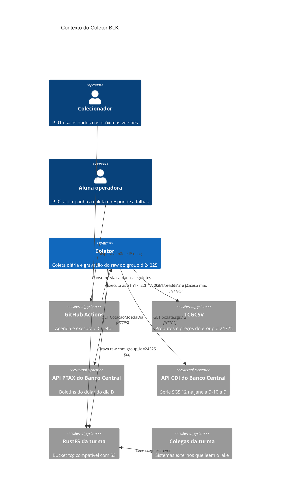
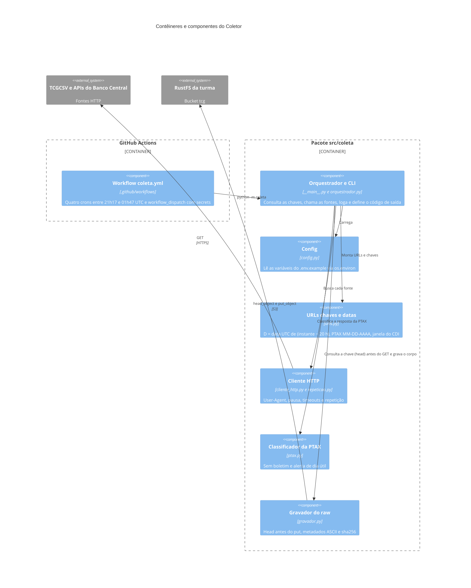
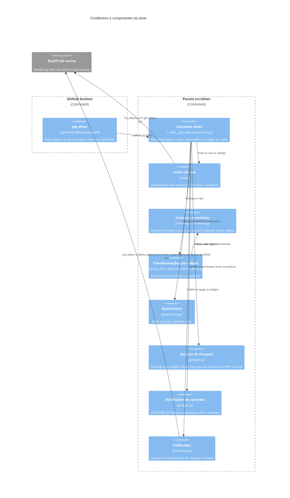
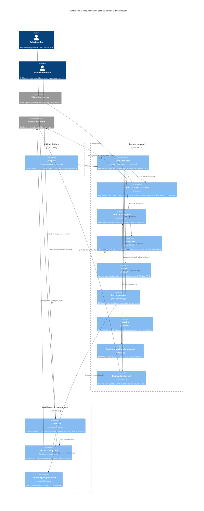

# Plano — Coleta diária e camada bruta (versão 1)

Cobre `specs/spec.md` v1 (RF-01 a RF-12, RNF-01 a RNF-04) e o adendo de 2026-11-18 (RF-12 alterado, RF-25 e RF-26: proteção contra atraso do agendador) e o adendo de 2026-11-19 (nova D, RF-25 substituído). A camada silver da spec v2 (RF-13 a RF-24, RNF-05 e RNF-06) está na seção "Camada silver (spec v2)", no fim deste arquivo. Tarefas em `specs/tasks.md`. Personas em `docs/00_persona.md`.

## Diagrama C4 de contexto

Nomes usados no texto: Colecionador, Aluna operadora, Coletor, TCGCSV, API PTAX do Banco Central, API CDI do Banco Central, RustFS da turma, GitHub Actions, Colegas da turma.

## Diagrama C4 de contêineres e componentes

Nomes usados no texto: Workflow coleta.yml, Orquestrador e CLI, Config, URLs chaves e datas, Cliente HTTP, Classificador da PTAX, Gravador do raw.

## Escolhas técnicas

| Escolha | Alternativa descartada | Requisito |
|---|---|---|
| Python 3.14 com `.venv` e `requirements.txt` com versões fixadas, igual no local e no Actions | Poetry ou uv | RF-12 |
| `requests` com uma `Session` (User-Agent na sessão, timeout `(10, 30)`) | httpx, urllib | RF-01 a RF-04, RNF-01, RNF-02 |
| Pausa medida com relógio monotônico desde a última chamada ao TCGCSV | `sleep` fixo antes de cada chamada | RNF-01 |
| Repetição em laço próprio: backoff exponencial com jitter, Retry-After, teto de 60 s, 5 tentativas | `urllib3.Retry` ou tenacity (dificultam contar tentativas e limitar o Retry-After) | RF-09, RF-10 |
| Gravar os bytes de `response.content` e calcular o sha256 com `hashlib` sobre esses bytes | Gravar `response.json()` serializado de novo | RF-05, RF-07 |
| boto3 com endpoint do `.env`, região us-east-1 e `addressing_style` path | s3fs, minio-py | RF-05, RF-07 |
| `head_object` antes do `put_object`: 404 grava, existente vira ja_existia | Put condicional `If-None-Match` (suporte no RustFS: hipótese, validação pendente) | RF-06 |
| Recusa de chave sem `group_id=24325` antes de qualquer chamada S3 | Confiar só na montagem da chave | RNF-04 |
| Metadados `x-amz-meta-*` validados como ASCII antes do put | Tags de objeto | RF-07 |
| datetime e timedelta da stdlib em UTC: D = (instante − 20 h).date() | D pelo fuso America/Sao_Paulo (regra até 2026-11-18) ou pytz | RF-03, RF-04, RF-05 |
| CLI sem parâmetro de data: D sai sempre do instante da coleta (RF-05) | Parâmetro `--data` (gravaria preço de hoje com data passada) | RF-05, OBJ-02 |
| python-dotenv carregado só se houver `.env` local; no Actions vale só o ambiente | dotenv também em produção | RNF-03 |
| pytest com marcadores `integracao` e `vcr` | unittest | verificação de todos os RF e RNF |
| vcrpy com pytest-recording, `filter_headers` de Authorization, `record_mode=none` na execução normal | Biblioteca responses ou chamadas reais nos testes | RF-01 a RF-04, RF-08, RNF-03 |
| Testcontainers com MinIO `coollabsio/minio:RELEASE.2025-10-15T17-29-55Z` | moto (não exercita um servidor S3 real) | RF-05, RF-06, RF-07, RNF-04 |
| `logging` da stdlib na saída padrão, uma linha JSON por fonte mais um resumo | Arquivo de log no runner (descartado no fim do job) | RF-10 |
| GitHub Actions com crons `17 21 * * *`, `47 22 * * *`, `17 0 * * *` e `47 1 * * *`, `workflow_dispatch`, secrets e `concurrency` | Railway; um único cron (o atraso de 17/11 mostrou que uma execução só não basta) | RF-12, RNF-03, RF-06 |
| ~~Checagem da janela de 20:00 a 02:59 UTC no orquestrador, com o relógio injetado, depois de carregar a config e antes de criar os clientes HTTP e S3~~ Substituída em 2026-11-19 pela nova D (RF-05): a janela perdia o dia quando todas as execuções atrasavam | Condição `if` de horário no workflow (não cobre o disparo manual nem o atraso do runner depois do início do job) | RF-25, RF-11 |
| `head_object` da chave de cada fonte antes do GET; GET só quando a chave não existe. O gravador mantém o próprio head antes do put | Baixar sempre e checar só antes do put (até quatro downloads do TCGCSV por noite) | RF-26, RF-06, RNF-01 |

Notas:
- Os minutos 17 e 47 evitam o atraso do GitHub em hora cheia. A D sai de `data_coleta` = data UTC de (instante − 20 h), então um atraso não muda a D enquanto a execução começar antes das 20h UTC do dia seguinte.
- Uma execução atrasada grava sob a D correta: se a chave já existe, registra ja_existia sem GET (RF-26); se não existe, grava o dado da última atualização.
- O `concurrency` impede duas execuções simultâneas entre o head e o put, que é a janela de corrida do RF-06.
- Testes de unidade não usam rede nem Docker. Cliente S3, sessão HTTP, relógio, `sleep` e gerador aleatório são injetados como dependências falsas. O "servidor simulado lento" do RNF-02 é uma sessão falsa que lança timeout.
- A primeira execução da noite faz 4 chamadas HTTP, ou até 20 com 5 tentativas cada; as seguintes só fazem as 4 consultas de chave no S3 e nenhuma chamada HTTP para as fontes já gravadas (RF-26). Isso fica muito abaixo das 10.000 por dia do RNF-01.

## Onde o log fica

- **Saída padrão:** o Coletor escreve uma linha JSON por fonte com URL, status HTTP, tentativas, bytes, sha256, resultado (gravado, ja_existia ou erro) e as marcas do RF-08. Depois escreve uma linha de resumo com o código de saída. O GitHub Actions captura essa saída no histórico de cada execução (RF-10, RF-12).
- **Cópia em `docs/evidencias/`:** fica só para as execuções relevantes (primeira execução real, segunda execução com ja_existia, falha forçada), em arquivo `.md`, porque o `.gitignore` ignora `*.log`. Antes do commit, a cópia é revisada para garantir que não contém segredos (RNF-03).
- O log nunca inclui cabeçalhos HTTP, credenciais nem o valor de variáveis de ambiente (RNF-03).

## Decisão de ordem das tarefas

**Decisão:** a integração com Testcontainers (T-11) e os testes de contrato com VCR (T-12) ficam para depois da primeira execução real (T-09) e do workflow (T-10).
**Motivo:** a fonte só devolve o preço do dia, e a série começa no primeiro dia coletado (fato da spec). Hoje é 11/11/2026 e a entrega é 12/12/2026, então cada dia sem coletar é perdido. Antecipar a coleta agendada vale mais que antecipar essas duas camadas de teste.
**Mitigação:** cada tarefa de T-01 a T-10 tem o seu teste de unidade. A T-09 só roda com autorização explícita para gravar no bucket. A recusa de sobrescrita é conferida no bucket real na T-09 (duas execuções) antes de existir o teste com MinIO.
**Risco aceito:** até a T-11, o comportamento contra um S3 real só é provado pela T-09 e pelas execuções agendadas.

# Camada silver (spec v2)

Cobre RF-13 a RF-24, RNF-05 e RNF-06 de `specs/spec.md` v2. Tarefas T-14 a T-27 em `specs/tasks.md`. Nada do que está acima (coleta) muda.

## Diagrama C4 de contêineres e componentes da silver

Nomes usados no texto: Job silver, Comando silver, Leitor do raw, Contrato e modelos, Transformações por tabela, Quarentena, Escritor do Parquet, Verificador do contrato, Publicador, RustFS da turma.

## Escolhas técnicas da silver

| Escolha | Alternativa descartada | Requisito |
|---|---|---|
| Pydantic v2: um `BaseModel` por tabela, com `field_validator`, `model_validate` e `model_dump` | dataclasses com validação manual | RF-20 |
| Contrato num dicionário único (tabela → colunas mínimas e tipos DuckDB), fonte do `CREATE TABLE` e da verificação | Tipos derivados dos modelos Pydantic (DATE e TIMESTAMP não mapeiam um para um) | RF-13 a RF-18, RF-23 |
| DuckDB grava o Parquet localmente: `CREATE TABLE` nos tipos do contrato e `COPY TO` (mesmo motor da gold, Aula 04) | pyarrow ou pandas (inferem tipos, outra pilha) | RF-13 a RF-18 |
| `DESCRIBE SELECT * FROM read_parquet(...)` no arquivo gerado, comparado com o contrato, com colunas extras aceitas | Confiar no esquema da tabela em memória | RF-23 |
| boto3 para ler o raw e publicar, reaproveitando `carregar_config` e `criar_cliente_s3` do pacote coleta | DuckDB httpfs com `s3://` direto (contornaria a guarda) | RNF-05, RNF-06 |
| Leitura só nos prefixos `raw/<fonte>/group_id=24325/`, com `list_objects_v2` e `get_object` | Listar o bucket inteiro | RNF-06, RF-14, RF-17, RF-18 |
| Guarda `chave_silver_permitida` (prefixo `silver/` ou `quarentena/`, um segmento `group_id=24325`, nunca `raw/`), reaproveitando `chave_permitida` e chamada dentro das únicas funções de put e delete | Confiar na montagem das chaves | RNF-05, RNF-06 |
| Quarentena em JSON Lines em `quarentena/<tabela>/group_id=24325/data=D/registros.jsonl`, com uma linha `{motivo, chave_raw, gerado_em, entrada}` em ordem determinística | Parquet (a entrada original é heterogênea) ou um arquivo por registro | RF-21, RF-24 |
| Ordem fixa: gerar tudo num diretório temporário, verificar todas as tabelas, publicar com put e depois apagar os objetos antigos não regravados | Apagar antes de gerar | RF-23, RF-24 |
| Linhas ordenadas pelas chaves de cada tabela antes do `COPY` e registros da quarentena ordenados por chave_raw e posição no raw | Ordem de leitura do raw | RF-24 |
| `python -m silver` (pacote `src/silver`), sem parâmetro: a geração diária e o reprocessamento são o mesmo comando, que reconstrói tudo | Comando incremental por D | RF-24 |
| Log JSON na saída padrão: uma linha por tabela e um resumo, como o coletor | Arquivo de log no runner | RF-22 |
| Job `silver` separado no workflow, com `needs: coleta` e `if: always()`: se falhar, fica vermelho sem marcar a coleta como falha | Passo no mesmo job da coleta | RF-22, RNF-05 (RF-11 da coleta preservado) |
| Testes de unidade com S3 falso em memória e corpo dos cassetes como entrada; integração com MinIO | Bucket real | RNF-06, verificação dos RF |

Notas:
- As versões de pydantic e duckdb são fixadas no `requirements.txt` na T-14, com wheel para Python 3.14.
- **Idempotência (RF-21 x RF-24):** `gerado_em` é a data real da geração e muda a cada execução. A comparação de "mesmas linhas" da quarentena considera todos os campos exceto `gerado_em`. As tabelas da silver são comparadas linha a linha, com todos os campos.
- D da quarentena é a data da partição `data=D` do raw de origem. A colecao não vem do raw e não tem quarentena.
- A silver nunca escreve em `raw/`. O Leitor do raw não recebe funções de escrita, e o Publicador recusa qualquer chave fora de `silver/` e `quarentena/` com `group_id=24325`.
- Com os quatro horários da coleta (RF-12), o job silver roda até quatro vezes por noite. Como o reprocessamento é idempotente, as execuções seguintes publicam as mesmas linhas.

## Onde a silver roda
- **Comando próprio:** `PYTHONPATH=src python -m silver`, separado do coletor (`python -m coleta`). A silver não altera nada no pacote coleta além de reaproveitar `carregar_config`, `criar_cliente_s3` e `chave_permitida`.
- **No workflow:** um job `silver` depois do job da coleta (`needs: coleta`, `if: always()`), com os mesmos secrets. Uma falha da silver deixa só esse job vermelho. A coleta e o seu código de saída (RF-11) não mudam, e a silver não grava no raw (RNF-05). Essa decisão vira a última tarefa (T-27), depois da primeira geração real (T-26).

## Respostas às lacunas da spec v2
- **Nome e formato da quarentena:** um arquivo `registros.jsonl` por tabela e por D, em `quarentena/<tabela>/group_id=24325/data=D/`. Cada linha é um objeto JSON com `motivo`, `chave_raw`, `gerado_em` (UTC, ISO 8601) e `entrada` (o registro como veio do raw).
- **Silver junto ou separada da coleta:** separada, em comando e job próprios, como descrito acima.
- **Formato do log da silver:** saída padrão, igual ao coletor.

## Decisão de ordem das tarefas da silver
- A T-14 define o contrato, os modelos e a estrutura do registro rejeitado. Por isso as transformações (T-16 a T-19) não dependem da T-21, que só grava o JSON Lines.
- As transformações vêm antes da escrita do Parquet (T-22), porque são funções puras testáveis com os cassetes.
- A publicação (T-23) é a primeira tarefa que escreve no S3 e só entra depois da verificação do contrato (T-22).
- A primeira geração real (T-26) vem antes do job no workflow (T-27), para conferir os selados (RF-15) e o log antes de agendar.

# Gold, carteira e dashboard (spec v3)

Cobre RF-27 a RF-50 e RNF-07 de `specs/spec.md` v3. Tarefas T-29 a T-54 em `specs/tasks.md`. Nada do que está acima (coleta e silver) muda: a gold só reaproveita funções dos pacotes coleta e silver.

## Diagrama C4 de contêineres e componentes da gold, da carteira e do dashboard

Nomes usados no texto: Job gold, Comando gold, Leitor da silver da turma, Contrato da gold, Dimensões, Fatos, Decomposição, Carteira, Escritor e verificador da gold, Publicador da gold, Dashboard, Consultas do painel, Leitor da gold publicada, Aluna operadora, Colecionador, Silver dos colegas, RustFS da turma.

## Escolhas técnicas da gold, da carteira e do dashboard

| Escolha | Alternativa descartada | Requisito |
|---|---|---|
| Silver de todas as coleções lida com boto3 (`list_objects_v2` em `silver/<tabela>/` e `get_object`) para um diretório temporário e consultada localmente no DuckDB | DuckDB httpfs com `s3://` e curinga (credenciais dentro do DuckDB, sem controle de só leitura) | RF-27, RNF-06 |
| `read_parquet(..., hive_partitioning = false)` em toda leitura de Parquet da turma | Detecção automática de partição (group_id BIGINT vindo do caminho, achado da T-22) | RF-27, RF-49 |
| DESCRIBE de cada arquivo comparado com `CONTRATO` de `silver.contrato` (reaproveitado), mais group_id do arquivo igual ao do segmento `group_id=<id>` do caminho | `union_by_name` sobre todos os arquivos | RF-27, RF-28 |
| Coleção fora do contrato sai inteira, com "alerta: colecao fora do contrato" e código 0; se for a 24325, nada é publicado e o código é 1 | Derrubar a gold inteira | RF-28, RF-50 |
| Um Parquet por tabela em `gold/group_id=24325/<tabela>.parquet` (fecha a lacuna de formato da spec) | Arquivo `.duckdb` único (binário, preso à versão do DuckDB, colegas precisam do DuckDB para ler) | RF-29 a RF-34, RF-50 |
| Contrato da gold e do carteira.parquet num dicionário em `src/gold/contrato.py`, fonte do CREATE TABLE e da verificação, como na silver | Tipos inferidos do SELECT | RF-29 a RF-34, RF-48 |
| Gold em SQL no DuckDB em memória; PTAX por `ASOF JOIN` com data_ptax ≤ data | pandas `merge_asof` | RF-33, RF-34, RF-35 |
| dim_data com `generate_series` da menor à maior data da preco_diario das coleções aprovadas (decisão da aluna em 2026-11-23) | Intervalo do câmbio e do CDI (a janela do CDI começa 10 dias antes de d0) | RF-31, RF-33 |
| Dias desde o lançamento como expressão na consulta (`data - data_lancamento`) | Coluna guardada na gold | RF-36 |
| Decomposição em função Python pura sobre números | Coluna na gold ou cálculo dentro da página | RF-37 |
| Carteira em funções Python puras; a composição recebe só as linhas de d0, e taxa_venda é parâmetro | SQL com acesso à série inteira (permitiria usar o futuro sem perceber) | RF-44, RF-45, RF-47 |
| Preço carregado só em memória no cálculo da carteira | Preencher a fato_preco_diario ou a silver | RF-46 |
| Gold e gold_turma gravadas localmente com COPY TO, verificadas com DESCRIBE e publicadas na ordem verificar, publicar, apagar, como a silver | Escrita direta no S3 | RF-48, RF-50 |
| Guarda `chave_gold_permitida` (só `gold/group_id=24325/` e `gold_turma/carteira/group_id=24325/`) dentro das únicas funções de put e delete da gold | Reaproveitar `chave_silver_permitida` (permitiria silver/ e quarentena/) | RNF-07 |
| `python -m gold` (pacote `src/gold`), sem parâmetro, que gera a gold e a carteira, com log JSON e códigos 0, 1 e 2 como a silver | Comando separado para a carteira (dois comandos, duas publicações) | RF-50 |
| Dashboard em Streamlit, só local (`streamlit run dashboard/app.py`, credenciais do ambiente; decisão da aluna em 2026-11-23) | Streamlit Community Cloud (segredos num serviço externo) | RF-38 |
| Consultas puras em `src/painel/consultas.py` sobre DuckDB, testadas sem Streamlit; a página só exibe; a chave reais ou dólar testada com `streamlit.testing.v1.AppTest` | Lógica dentro da página | RF-38 a RF-43, RF-49 |
| Dashboard lê a gold publicada com boto3 e `st.cache_data` (ttl de 1 h; hipótese, validação pendente), sem nenhum put nem delete | Ler a gold gerada localmente | RF-38, RF-49, RNF-06 |
| Gráficos em Altair (versão fixada no `requirements.txt`) com linha nula no dia sem coleta, que quebra a linha | Interpolar; plotly (outra dependência) | RF-38 |
| Placar com a mesma leitura do RF-27 em `gold_turma/carteira/*/`, conferindo o contrato do RF-48 | Ler sem conferir o esquema | RF-49 |
| Job `gold` com `needs: silver` e `if: always() && needs.silver.result == 'success'`, mesmos secrets | Rodar mesmo com a silver falhando (leria uma silver mista, RF-24) | RF-50, RNF-07 |
| Testes de unidade com Parquet sintético em `tmp_path` e S3 falso; integração com MinIO em Testcontainers | Bucket real | RNF-06, RNF-07, verificação dos RF |

Notas:
- streamlit e altair entram no `requirements.txt` na T-46, com versões fixadas e wheel para Python 3.14. O pandas vem como dependência do Streamlit; na mesma tarefa, o tempo da suíte é medido de novo (pendência da T-22).
- **Idempotência (RF-50):** as linhas de cada tabela são ordenadas pelas chaves antes do COPY, como na silver. A gold não tem campo de data de geração.
- A PTAX e o CDI vêm só da silver desta coleção (suposição da spec v3), também para converter os preços das outras coleções.
- A gold nunca escreve em raw/, silver/ nem quarentena/: o Leitor da silver da turma não recebe funções de escrita e o Publicador da gold recusa qualquer chave fora dos dois prefixos do RNF-07.

## Onde a gold e o dashboard rodam
- **Comando próprio:** `PYTHONPATH=src python -m gold`, separado da coleta e da silver. Gera as tabelas da gold e o carteira.parquet num diretório temporário, verifica tudo, publica e só então apaga os objetos antigos não regravados (RF-50).
- **No workflow:** um job `gold` depois do job silver, só com a silver em sucesso. Uma falha da gold deixa só esse job vermelho; a coleta e a silver não mudam.
- **Dashboard:** só local, `PYTHONPATH=src streamlit run dashboard/app.py`, com as credenciais do ambiente, lendo a gold publicada.

## ADRs exigidas pela spec v3
Todas em `docs/adr/`, no formato Status, Contexto, Decisão, Consequências e Requisitos:
- `0001-gold-modelagem-estrela.md` (T-31): fatos e dimensões, grão de cada fato, coleções aprovadas, um Parquet por tabela, dias desde o lançamento na consulta (RF-29 a RF-34, RF-36). Commit antes do código da gold.
- `0002-carteira-selado-sem-case-display.md` (T-39): selado de maior market_price_usd com preço em d0, sem produtos cujo nome termina em "Case" ou "Display"; acima de R$ 1.000, 0 unidades (RF-44).
- `0003-cesta-raras-unidades-inteiras-sem-code-cards.md` (T-39): R$ 100 por par, unidades inteiras, sobra em caixa rendendo CDI, Code Cards fora, desempate (RF-44).
- `0004-taxa-de-venda-15.md` (T-39): taxa_venda como parâmetro, 15% como hipótese, só sobre produtos, resultados com 0 e 0,15 (RF-45).
- `0005-carteira-propria.md` (T-39): regra da carteira "propria", decidida pela aluna na T-39 e ainda não definida neste plano; só informação de d0 (RF-44).
- Os ADRs 0002 a 0005 são commitados antes de qualquer cálculo da carteira (T-40).

## Decisão de ordem das tarefas da gold
- A conferência das raridades da P2 (T-30) fica separada da leitura da silver (T-29): uma é execução real com evidência e a outra é código com testes de unidade.
- O ADR da estrela (T-31) vem antes de qualquer código da gold; os ADRs da carteira (T-39) vêm antes de qualquer cálculo da carteira.
- Escrita e publicação (T-36) ficam separadas do comando e do log (T-37), como na silver (T-22 a T-24); liquidação com CDI (T-41) fica separada de preço carregado e métricas (T-42).
- A primeira gold real (T-44) e o job no workflow (T-45) vêm antes do dashboard: confirmam com dados reais a data_ptax de 21/11 e 22/11 e quantas coleções da turma passam no contrato (lacuna da spec), antes de P3 a P5, e deixam a gold atualizada todo dia enquanto o dashboard é feito. A ordem "execução real, depois workflow" é a da silver (T-26, T-27).
- O painel da carteira (T-52) e a conferência visual (T-54) cobrem as marcas e conferências pedidas pelo RF-38 e pelo RF-46.
